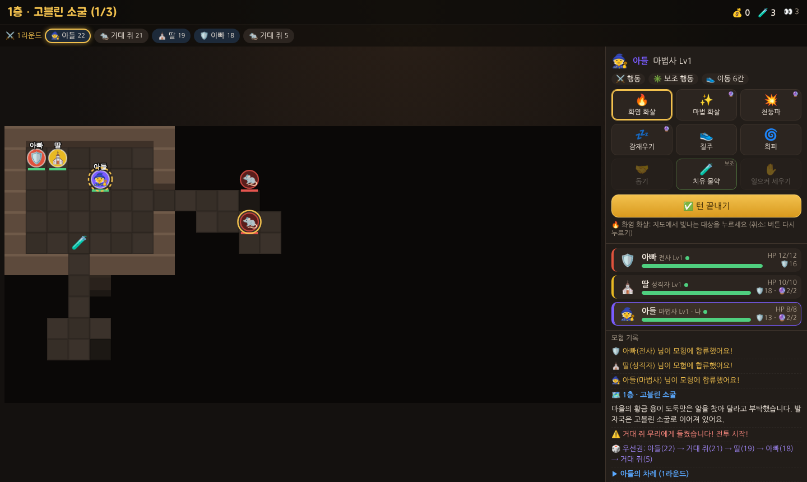
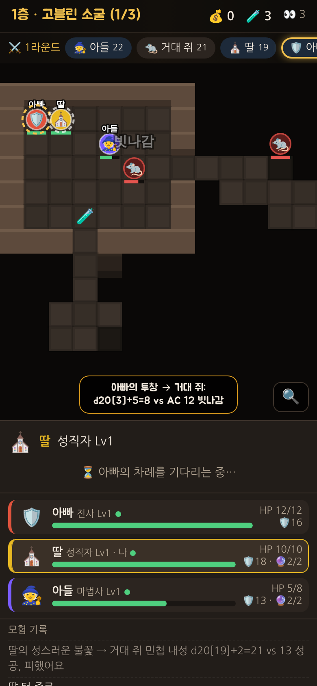

# 🐉 황금 용의 던전

아빠와 아이들이 **집 와이파이 하나로 함께하는** 협동 던전 게임입니다.
옛날 던전 앤 드래곤(D&D)의 규칙을 공개 규칙서(SRD 5.1)에서 복원하고, 요즘 게임처럼 계산은 컴퓨터가 대신 해 주도록 다듬었어요.



## 준비물

- **게임을 켜는 PC 1대 (호스트)**: [Node.js](https://nodejs.org/ko/download) LTS 버전만 설치하면 돼요.
- **나머지 PC·핸드폰**: 아무것도 설치하지 않아요. 같은 와이파이에 연결된 상태에서 크롬/엣지/사파리로 접속만 하면 됩니다.

## 실행하는 법 (Windows)

1. 호스트 PC에서 이 저장소를 받습니다. GitHub 페이지의 **Code → Download ZIP**으로 받아 압축을 풀어도 돼요.
2. `games/golddragon` 폴더의 **`시작하기.bat`** 을 더블클릭합니다.
   - Node.js가 없으면 설치 페이지가 열려요. 설치 후 다시 더블클릭하세요.
   - 처음 실행할 때 **Windows 방화벽 창**이 뜨면 **"개인 네트워크"에 체크하고 허용**을 눌러 주세요. 이걸 막으면 다른 PC가 들어올 수 없어요.
3. 검은 창에 주소가 나옵니다.
   ```
   이 PC에서:        http://localhost:8080
   다른 PC·핸드폰:   http://192.168.0.12:8080
   ```
4. 다른 PC와 핸드폰의 브라우저 주소창에 **`http://192.168.x.x:8080`** (창에 나온 그대로)을 입력합니다.
5. 각자 이름과 직업을 고르고 **참가하기**, 모두 모이면 아무나 **⚔️ 모험 시작**을 누릅니다.

> 검은 창을 닫으면 게임이 꺼집니다. 진행 상황은 `save.json`에 **자동 저장**되어, 다음에 `시작하기.bat`을 다시 켜면 하던 층·레벨·골드 그대로 이어서 할 수 있어요. 처음부터 하고 싶으면 `save.json`을 지우세요.

Mac/Linux에서는 이 폴더에서 `npm start` (또는 `node server.js`)로 켤 수 있어요. 포트를 바꾸려면 `PORT=9000 npm start`.

## 핸드폰으로 보기·하기

같은 와이파이에 연결된 핸드폰으로 같은 주소에 들어오면 화면이 세로형으로 바뀌어요. 지도는 지금 차례인 캐릭터를 따라 확대되고, 🔍 버튼으로 전체 지도를 볼 수 있어요. 참가하지 않으면 구경만 할 수도 있어요.



## 게임 방법

- **목표**: 3층짜리 던전(고블린 소굴 → 망자의 지하묘지 → 붉은 용의 둥지)을 내려가 어린 붉은 용을 물리치고 황금 용의 알을 되찾기.
- **탐험**: 지도를 눌러 자유롭게 움직여요. 🎁 보물상자와 🧪 물약은 밟으면 주워요. 아직 우리를 못 본 적(❔)을 먼저 공격하면 **기습**(유리함)!
- **전투**: 적에게 들키면 우선권(주사위)을 굴려 차례가 정해져요. 내 차례에는
  - 👟 **이동** (파란 칸, 6칸까지)
  - ⚔️ **행동** 1번 (공격, 주문, 돕기, 회피, 질주, 일으켜 세우기)
  - ✳️ **보조 행동** 1번 (물약, 치유의 말씀, 재정비 등)
  - 을 하고 **✅ 턴 끝내기**를 누르면 돼요. 몬스터 차례는 자동으로 진행됩니다.
- **쓰러지면**: HP가 0이 되면 쓰러져서 매 차례 죽음 내성 주사위를 굴려요. 동료가 치유하거나 옆에서 **일으켜 세우기**를 하면 다시 싸울 수 있고, 전투가 끝나면 모두 깨어나요. 영웅이 죽지는 않아요.
- **전멸해도 괜찮아요**: 모두 쓰러지면 황금 용의 가호로 그 층 입구에서 다시 시작해요.
- **휴식과 레벨업**: 층마다 한 번 🏕️ 짧은 휴식(HP 절반 회복). 계단(⬇️)으로 내려가면 모두 완전히 회복하고 **레벨업**해요 (최대 3레벨).
- 한 PC에서 영웅 두 명을 움직여도 되고, 누가 자리를 비우면 다른 사람이 그 영웅의 턴을 대신 넘길 수 있어요.

### 직업

| 직업 | 특징 | 주요 능력 |
| --- | --- | --- |
| 🛡️ 전사 | HP·방어도 최고, 앞에서 막기 | 롱소드, 투창, 재정비(회복), 2레벨 기세 폭발(행동 2번), 3레벨 19~20 치명타 |
| 🧙 마법사 | 약하지만 강력한 주문 | 화염 화살(무제한), 마법 화살(백발백중), 천둥파(주변 전체), **잠재우기** |
| ⛪ 성직자 | 치유와 언데드 퇴치 | 철퇴(해골에게 2배), 성스러운 불꽃, 상처 치료, 치유의 말씀, 2레벨 언데드 퇴치 |
| 🗝️ 도적 | 기습 공격 한 방 | 단검·단궁 + **기습 공격**(동료가 적 옆에 있거나 유리할 때 추가 피해), 2레벨 숨기·재빠른 질주 |

**팁**: 해골은 철퇴 같은 타격에 약하고, 좀비는 쓰러져도 다시 일어날 수 있어요(광휘 피해나 치명타로는 못 버텨요). 붉은 용은 **화염에 면역**이에요!

## 만든 방식 (역공학)

상업용 D&D 게임의 코드나 그림을 뜯어 쓰지 않고, 공개된 규칙서 **SRD 5.1** 을 "명세서"로 삼아 규칙을 역으로 재구성했어요.

- **그대로 복원한 규칙**: d20 + 보너스 vs 방어도(AC) 명중 판정, 20은 치명타(주사위 2배)·1은 실패, 유리/불리(주사위 2개), 내성 굴림과 DC, 우선권, 주문 슬롯, 죽음 내성, 원거리 공격 시 근접한 적이 있으면 불리, 몬스터 능력치(고블린, 코볼트, 해골, 좀비, 거대 쥐, 붉은 용 새끼 등), 해골의 타격 약점, 좀비의 끈기, 잠재우기의 HP 순서 규칙.
- **요즘 식으로 바꾼 부분**: 모든 계산과 주사위는 자동, 결과는 기록창에 식까지 보여 줌(`d20[14]+5=19 vs AC 15`) / 아군 오인 사격 없음 / 기회 공격 생략 / 영웅은 죽지 않고 쓰러짐 / 전멸 시 층 재시작 / 파티 공용 물약을 보조 행동으로(2024 규칙) / 치유 주문 강화(상처 치료 2d8+3, 치유의 말씀 2d4+3) / 3명 파티에 맞춰 보스 HP 조정.

## 개발

```bash
npm test     # 규칙 단위 테스트 + 자동 플레이로 1층부터 용까지 클리어하는지 확인
npm start
```

| 파일 | 내용 |
| --- | --- |
| `data.js` | 직업·능력·몬스터·층 지도 (글자로 그린 지도) |
| `game.js` | 규칙 엔진 (상태는 순수 JSON이라 그대로 저장) |
| `server.js` | 호스트 서버: 화면 파일 제공, 실시간 상태 전송(SSE), 몬스터 턴 진행, 자동 저장. 외부 패키지 없음 |
| `public/` | 브라우저 화면 (PC·핸드폰 겸용) |

## 라이선스 표기

This work includes material taken from the System Reference Document 5.1 ("SRD 5.1") by Wizards of the Coast LLC and available at https://dnd.wizards.com/resources/systems-reference-document. The SRD 5.1 is licensed under the Creative Commons Attribution 4.0 International License available at https://creativecommons.org/licenses/by/4.0/legalcode.

이 게임은 비공식 팬 게임이며 Wizards of the Coast와 관련이 없습니다.
